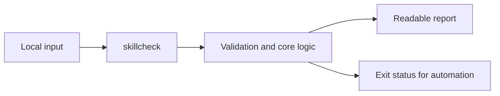

# skillcheck

<div align="center">
  
  <br/>
  
  
  
</div>

> Validate agent skill Markdown files for required metadata, structure, and broken local references.

## Why it exists

A focused, inspectable starter for a real developer workflow. It favors explicit behavior, local execution, and small pieces that are easy to understand and extend.

## Features

- Checks YAML-style frontmatter without executing it
- Validates name, description, and recommended sections
- Finds broken relative links and missing local files
- Readable diagnostics with non-zero CI exit status

## Architecture



## Requirements

- Python 3.10+ / standard library
- A terminal and a local checkout of this repository

## Quick start

```bash
python src/skillcheck.py path/to/SKILL.md
```

## Example

```bash
python src/skillcheck.py examples/SKILL.md
```

## Project status and limitations

This repository contains an initial working implementation, not a production-certified product. Review the source and test it against your own fixtures before adopting it in critical workflows.

This is a lightweight structural linter, not a complete YAML parser or a guarantee that a skill is safe. Review instructions and permissions before enabling a skill.

## Roadmap

- [ ] Support directory-wide validation
- [ ] Add optional JSON Schema profiles
- [ ] Add format-specific checks for common agent clients

## Contributing

Issues and pull requests are welcome. Please include a small reproducible example for bug reports, keep changes focused, and add tests for new behavior. Do not submit secrets, private data, or generated artifacts.

## License

MIT. See [LICENSE](LICENSE). Third-party services or optional dependencies remain subject to their own terms.
